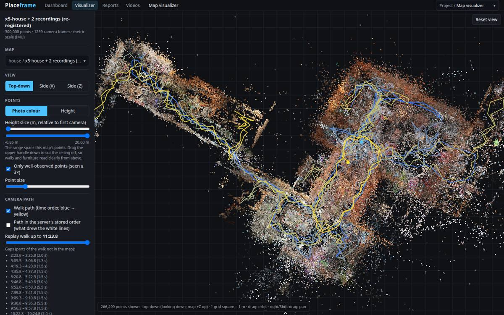

# Placeframe: findings, fixes and extensions from a self-hosted deployment

**To:** the Placeframe team · **Status:** for your review and feedback (updated Nov 17). The first issues and pull
requests are open; see "On GitHub" below.

We run Placeframe self-hosted on one RTX 3090 workstation, mapping homes with an Insta360 X5 (360° video) and
localizing phones against those maps. Our fork is based on `main` (May 2026); we have since compared it with
`dev`, `dev_hh` and your open branches (Nov 17) so that we only propose what you don't already have.

## Summary

- **Two fixes for large builds:** restart the reconstructor process after each job (a long-lived worker kept
  ~8 GB of host memory, which caused our out-of-memory kills), and limit progress output (one build printed
  ~209,000 log lines).
- **Builds 3–6× faster, and linear in size:** a prior-pose mapper and GPU bundle adjustment build an 8,370-image,
  three-recording house map in 35 min. Half-precision descriptors cut a 9,072-image build's peak RAM from 18 GB to
  11.9 GiB with the same map quality, so a ~20,000-image venue should fit one 32 GB machine.
- **Merges must follow odometry heading drift:** one rigid transform left part of a house as a second copy rotated
  32°. A piecewise alignment raised the map points shared with the existing map from 15% to 70%, and cut confidently
  wrong phone fixes from 31 to 6 of 286.
- **Tracking a moving phone on the server:** a per-session multi-hypothesis tracker over ARCore/ARKit odometry
  serves a pose within 0.5 m on 274–278 of 286 recorded frames. This differs from your client-side design, and we
  would value your view.
- **Cost:** a 10,000 m² venue map builds in ~1.3 h on one RTX 3090. Serving 3,000 attendees costs ~$28 per event
  day on marketplace GPUs with adaptive querying, which sends 4× fewer queries than 1 Hz at the same accuracy. Map
  egress between clouds can cost more than the GPUs.
- **What we ask:** review of the three open pull requests, and which of the larger changes you want as pull
  requests (#167).

## On GitHub

| Change | Issue | Pull request (against `dev`) |
|---|---|---|
| Restart the reconstructor process after each job | [#161](https://github.com/outernet-foundation/placeframe/issues/161) | [#164](https://github.com/outernet-foundation/placeframe/pull/164) |
| Limit reconstructor progress output | [#162](https://github.com/outernet-foundation/placeframe/issues/162) | [#165](https://github.com/outernet-foundation/placeframe/pull/165) |
| Half-precision descriptors in the reconstructor | [#163](https://github.com/outernet-foundation/placeframe/issues/163) | [#166](https://github.com/outernet-foundation/placeframe/pull/166) |
| Larger changes: which do you want, in what form? | [#167](https://github.com/outernet-foundation/placeframe/issues/167) | after your answer |
| Insta360 X5 capture source, with OpenVIO odometry | [placeframe-capture-tool#22](https://github.com/outernet-foundation/placeframe-capture-tool/issues/22) | after your answer |
| Flutter phone app for capture and localization (phone only) | [placeframe-capture-tool#23](https://github.com/outernet-foundation/placeframe-capture-tool/issues/23) | [placeframe-capture-tool#24](https://github.com/outernet-foundation/placeframe-capture-tool/pull/24) (against its `dev`) |

The three Placeframe pull requests are independent: they merge in any order. The Flutter app goes to
`placeframe-capture-tool`, beside CaptureTool; tell us if you prefer a separate repository.

## What it looks like

**The map.** A house built from three Insta360 X5 walks merged into one map (7,554 images; extensions 1–3 below),
seen from above in our map visualizer. Points are coloured from the photos; the lines are the three walks (blue →
yellow in time). Before the merge registration followed the X5's heading drift (extension 2), part of this house
appeared twice, rotated 32°.

**A phone walking through a second house.** A recorded 5-minute Android walk through all three floors of another
house (Fairhills Ct, a three-recording map of 8,370 images), replayed through tracked
localization (extension 4) at 5× speed. Left: the phone's camera. Right: the top-down map, cut to ±1 m around the
phone's height so other floors drop out, with the phone (white), its path registered to the map, and the
localizations that agreed (green). The phone moves on every frame using ARCore odometry between localizations. On
this walk the served pose is within 0.5 m on 277 of 286 localizations and wrong by more than 1 m on 6 (one stretch
with no usable views).

<video src="proposal_media/fairhills_walk_5x.mp4" poster="proposal_media/fairhills_walk_poster.jpg" controls preload="none" playsinline style="width:100%;border-radius:6px"></video>

## Already on your branches (we will drop ours)

| Our change | Yours |
|---|---|
| Stale-lease reap committed in its own transaction | `dev` lease server (`87790560`) |
| Reconstructor token refresh during long jobs | moot on `dev` (internal lease server, no auth) |
| Reconstructed frames written in capture order | `dev_hh` `c051b46c` (also writes frame ids) |
| Block `/internal` on the public endpoint | superseded by the internal lease server |
| Empty the localizer's CUDA cache; LightGlue in small batches | `oom-fix` `aca42dfd`, `dev_hh` `3f09dd9b` |
| Pass the localizer's 422 reason to clients | `dev_hh` `0b6a814e` |

## Fixes not on your branches

1. **Restart the reconstructor process after each job.** The real cause of our out-of-memory kills: a long-lived
   worker kept ~8 GB of host memory after each large build, so the next 7,000-image build swapped for an hour and
   was killed (the build itself peaks at 11 GB). `execv` after each job; opt out with a setting. Issue #161, pull
   request #164.
2. **Limit progress output.** One build printed ~209,000 log lines (170,000 from geometry verification); on `dev`
   the publisher still prints every tick. Print at the API flush rate and every 5%. Issue #162, pull request #165.

## Extensions: measurements and questions

1. **Fast prior-pose mapper.** Start frames at their capture poses and refine with pose-prior bundle adjustment
   instead of incremental mapping. Merging a recording into a ~2,000-image map: ~40 min instead of 4–6+ h; a full
   8,370-image, three-recording house map builds in 35 min. `dev_hh`'s merge flow still maps incrementally. Merges
   also reuse the base map build's features and matches (-18% build time on that map, same localization quality).
2. **Merge registration must follow heading drift.** A new recording registered to the map with one rigid
   transform (as `dev_hh`'s align step does with yaw/scale/translation) left part of our house as a second copy
   rotated 32°: the X5's odometry heading drifted 32° over a 14-minute walk. Phones then localized confidently on
   the wrong copy. We now fit the alignment piecewise along the recording (rotation and position, from
   localizations every ~5 s) and check the result: the share of the new recording's map points also seen by the
   rest of the map went from 15% to 70%, and confidently wrong phone fixes on a recorded walk from 31 to 6 of 286.
   A merge sharing under 30% is not allowed to replace the old map.
3. **GPU bundle adjustment** (Ceres + cuDSS). Your `AGENTS.md` measured no gain at 318 cameras. At our sizes it
   matters: one global BA on a ~1,250-frame map takes 29 s instead of 293 s; our merges are 7,000–8,400 images.
4. **Localization of a moving phone (a different design from yours, for discussion).** Your design docs put the
   multi-hypothesis filter on the client. We built it on the server (`POST /localize/track`): the client sends
   each frame with its ARCore/ARKit odometry pose and a session id; the localizer produces candidate poses per
   place (retrieved images grouped by location, plus images near the predicted pose, with no confidence gate) and a
   per-session tracker keeps every candidate alignment between the map and the odometry frame, merges duplicates
   (0.5 m / 10°, which addresses the duplicate-hypothesis problem in your false-lock diagnosis), and returns the most
   probable one with its probability. It also re-anchors after the odometry's own jumps (ARCore moved one walk
   5 m in a second). On a 286-frame recorded walk: the served pose is within 0.5 m on 274–278 frames and wrong by
   more than 1 m on 6, all in one stretch with no usable views. The client stays thin and needs no localization
   code. We would value your view on server versus client placement; our evaluation tools would apply to either.
5. **Evaluation without ground truth.** Recorded client sessions (image, camera, odometry) replay through the
   localizer; a reference alignment comes from the odometry's local consistency (correct matches in a short window
   imply the same map alignment), split at odometry jumps. This is how the numbers above were measured, and how
   we chose the settings below.
6. **Phone queries: smaller and fewer.** Phone frames are 480–1080 px; upscaling a 640×480 frame to 1,024 px
   (`LOCAL_FEATURE_RESIZE_SHORTER_SIDE`) cost accuracy: at 640 the right pose was found 6% more often in a third
   less time (we made the size a parameter; the default is unchanged). An adaptive query rate (every 5 s while
   fixes agree, every frame after a disagreement or an odometry jump) sent 4× fewer queries than 1 Hz with the same
   accuracy; for a 3,000-attendee venue it is the largest serving-cost factor.
7. **Portrait images.** Android phones held upright deliver sideways camera images; without the right
   `orientation` our matches fell from confidence 0.75 to 0.07. Your Unity provider hard-codes `LEFT_TOP` (a
   transpose) on Android: is that intended for ARFoundation's image layout, or worth checking for portrait use?
8. **Preemptible workers:** lease heartbeat, configurable lease timeout, and stage checkpoints (features,
   matches) in object storage so a re-leased job resumes. We would adopt your requeue-count cap.
9. **Map placement from capture GPS** (`location.json`, placed in ENU at the fix) and **server-side recording of
   localization requests** for replay (complements your client-side recorder).
10. **Half-precision descriptors in the reconstructor.** Builds held every image's local descriptors in RAM in full
   precision, trained the compression on a second full-precision copy of all of them, and moved all of them to the
   GPU for matching: a 9,072-image map peaked at 18 GB of RAM, so a ~20,000-image venue would not fit a 32 GB
   machine. Now descriptors stay in float16, each matching batch moves only its own images to the GPU, and OPQ/PQ
   train on a seeded 1M-descriptor sample. Same map: peak RAM 11.9 GiB, peak GPU 4.9 GB, 8,556 registered images
   (full precision: 8,508 and 8,532), median reprojection error 0.68 px (0.69); LightGlue's matches are identical in
   half and full precision. Issue #163, pull request #166.

A cost study (building and serving maps for a 10,000 m² venue with 3,000 attendees, measured on this pipeline):
[Cost study v2](https://28palomas-rtx3090.tail3fa327.ts.net/placeframe/reports/DYddaNp1_WGNuSrMNbhQS02Wke9Mxb6jew/)
(you can comment on any part of it). In short: a venue map builds in ~1.3 h on one RTX 3090, and serving
cost is dominated by how often phones query (adaptive querying: ~$28 per event day on marketplace GPUs) and by
map egress when GPUs and storage sit in different clouds.

Outside Placeframe (separate repository; happy to share): the Insta360 X5 pipeline (calibration, odometry,
merging, GPS; proposed as a capture source in
[placeframe-capture-tool#22](https://github.com/outernet-foundation/placeframe-capture-tool/issues/22), with an
odometry comparison: OpenVIO, with its native two-lens 360° camera model, had 0.82 m median error against the
map, better than OpenVINS and our own VIO at 1.53 m), a credential-free GPU fleet on rented interruptible GPUs (pre-signed object-storage URLs), a cost study (build compute, serving load, storage) and operations
tooling (dashboard, watchdog, backups, nightly localization regression checks).

## Where to look

The three fixes are open as pull requests against `dev` (see "On GitHub"), from our public fork
[`jcl5m1/placeframe`](https://github.com/jcl5m1/placeframe). The other changes are on our private deployment branch
[`local/main`](https://github.com/jcl5m1/placeframe-local/tree/local/main) (based on your `main`), one commit per
change. We will port the ones you want to `dev` and open them as pull requests (#167).

**The deployment branch and our pipeline repository are private.** If you want to read them before you decide,
send us GitHub usernames and we will give access. Until then the commit links below show GitHub's "not found" page.

| Item | Commits |
|---|---|
| Fix 1: restart the reconstructor after each job | [`64f0c372`](https://github.com/jcl5m1/placeframe-local/commit/64f0c372) |
| Fix 2: limit progress output | [`d173cc56`](https://github.com/jcl5m1/placeframe-local/commit/d173cc56), [`4f217cdd`](https://github.com/jcl5m1/placeframe-local/commit/4f217cdd) |
| Extension 1: prior-pose mapper; merge reuse | [`356939cc`](https://github.com/jcl5m1/placeframe-local/commit/356939cc); [`1922a9ca`](https://github.com/jcl5m1/placeframe-local/commit/1922a9ca), each job in an empty work folder [`73738326`](https://github.com/jcl5m1/placeframe-local/commit/73738326) |
| Extension 2: merge registration and check | in our pipeline repository ([`a488978`](https://github.com/jcl5m1/placeframe-insta360/commit/a488978)) |
| Extension 3: GPU bundle adjustment | worker image build in our pipeline repository (`gpu/`), no Placeframe code change |
| Extension 4: tracked localization | [`549d0ef4`](https://github.com/jcl5m1/placeframe-local/commit/549d0ef4) (API, localizer, tracker, tests), worker threads [`f5251e25`](https://github.com/jcl5m1/placeframe-local/commit/f5251e25), session routing across processes [`c7fbbeeb`](https://github.com/jcl5m1/placeframe-local/commit/c7fbbeeb), strict type checks [`4edf296c`](https://github.com/jcl5m1/placeframe-local/commit/4edf296c), regenerated clients [`e363c5a6`](https://github.com/jcl5m1/placeframe-local/commit/e363c5a6) |
| Extension 6: query size parameter | [`683136a4`](https://github.com/jcl5m1/placeframe-local/commit/683136a4); adaptive rate in the app [`46d0838f`](https://github.com/jcl5m1/placeframe-local/commit/46d0838f) |
| Extension 7: upright phone images | [`4b606387`](https://github.com/jcl5m1/placeframe-local/commit/4b606387) |
| Extension 8: preemptible workers | [`4d7a7673`](https://github.com/jcl5m1/placeframe-local/commit/4d7a7673), [`2ba41ebf`](https://github.com/jcl5m1/placeframe-local/commit/2ba41ebf), heartbeat fix [`f75eeac3`](https://github.com/jcl5m1/placeframe-local/commit/f75eeac3) |
| Extension 9: GPS placement; request recording | [`ddc88e58`](https://github.com/jcl5m1/placeframe-local/commit/ddc88e58), [`1fb9ed32`](https://github.com/jcl5m1/placeframe-local/commit/1fb9ed32); [`50621a68`](https://github.com/jcl5m1/placeframe-local/commit/50621a68) |
| Extension 10: half-precision descriptors | [`dc890b0f`](https://github.com/jcl5m1/placeframe-local/commit/dc890b0f) |
| Panoramic rig pairing | [`ba13a599`](https://github.com/jcl5m1/placeframe-local/commit/ba13a599) |
| Flutter client | [`5cb59995`](https://github.com/jcl5m1/placeframe-local/commit/5cb59995), [`b94ec1eb`](https://github.com/jcl5m1/placeframe-local/commit/b94ec1eb), [`4b606387`](https://github.com/jcl5m1/placeframe-local/commit/4b606387), [`46d0838f`](https://github.com/jcl5m1/placeframe-local/commit/46d0838f), [`64b61ade`](https://github.com/jcl5m1/placeframe-local/commit/64b61ade) |
| Already on your branches (for reference) | [`c229dbbe`](https://github.com/jcl5m1/placeframe-local/commit/c229dbbe), [`f0624a2b`](https://github.com/jcl5m1/placeframe-local/commit/f0624a2b), [`2bbdc88f`](https://github.com/jcl5m1/placeframe-local/commit/2bbdc88f), [`28af7704`](https://github.com/jcl5m1/placeframe-local/commit/28af7704), [`523429df`](https://github.com/jcl5m1/placeframe-local/commit/523429df) |

Our deployment overlay ([`476d9888`](https://github.com/jcl5m1/placeframe-local/commit/476d9888)) mounts these changes over your published images on one host; it is not
meant for upstream.

## Questions for you

1. Please review pull requests #164, #165 and #166.
2. Which of the larger changes do you want as pull requests, and in what form (#167)?
3. Are the merge findings (piecewise registration and the shared-points check) useful for `dev_hh`'s merge flow?
4. Server-side or client-side tracking: would you like the tracker and its evaluation tools as a reference, or
   ported to your client filter's interface?
5. Should GPU bundle adjustment come back as an option for large captures, given the numbers above?
6. Would you like any of our web tools? We checked `dev_hh`'s dashboard (#155) first: it already starts and follows
   reconstructions, has an interactive 3D point-cloud viewer with camera poses, and batch-localizes image folders,
   so we would not send those parts. What it does not have, and we could send:
   - **Upload of large recordings in the browser**, resumable after a dropped connection, with the build queue.
   - **Machine and build health:** GPU, CPU, memory and disk use; build progress with stall detection; a watchdog
     that restarts stuck services and shows the problems it cannot fix in a banner; and rented-GPU costs.
   - **Replay of recorded phone localization sessions** in a top-down map viewer (height slices, walk paths, the
     localizations along a session's timeline).
   - **Shareable reports** with comments anyone with the link can pin on the page (like this one).

   Our tools are a separate web service with its own login today; tell us if any of them would fit your dashboard.
