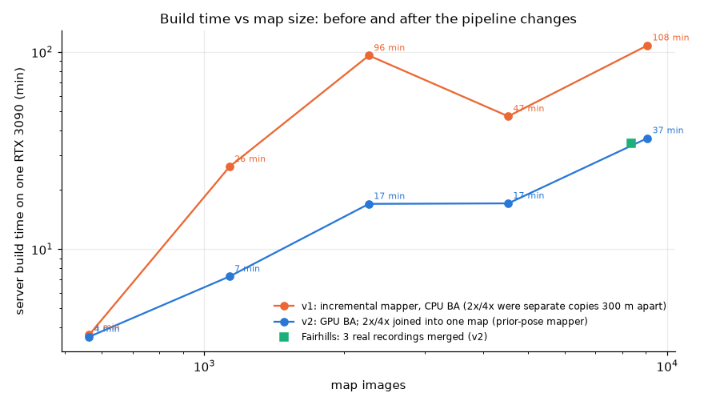
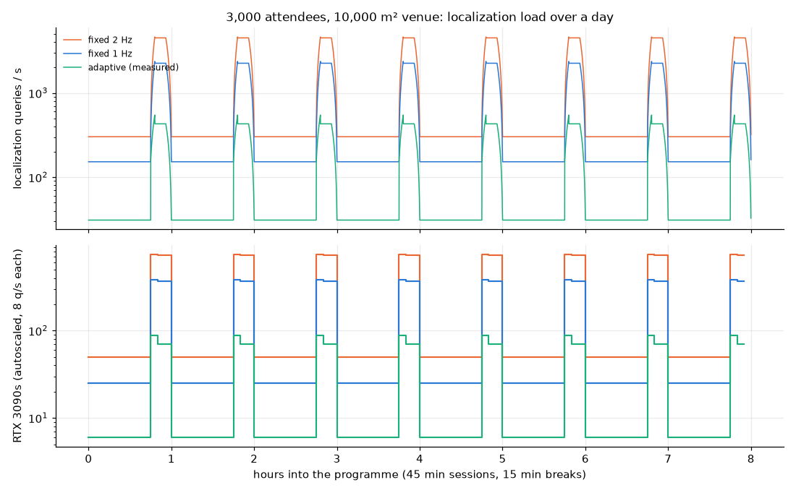
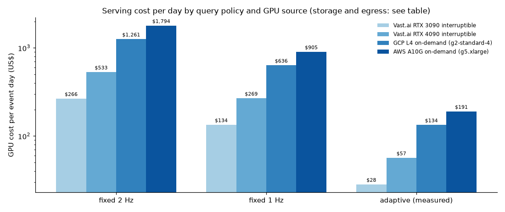
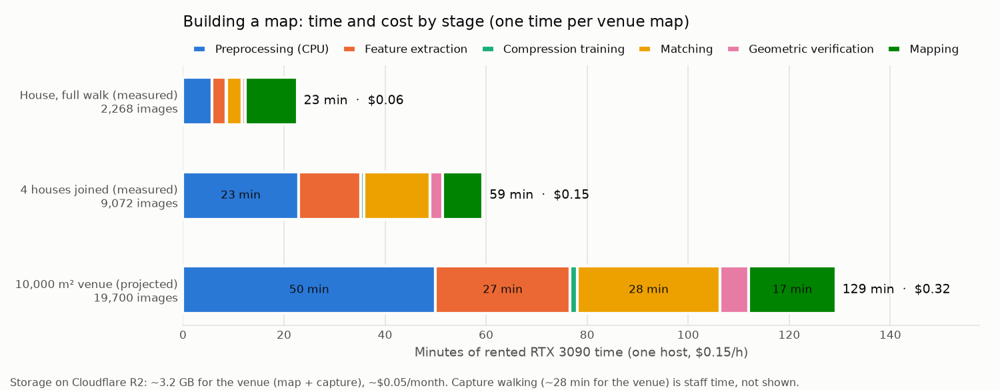
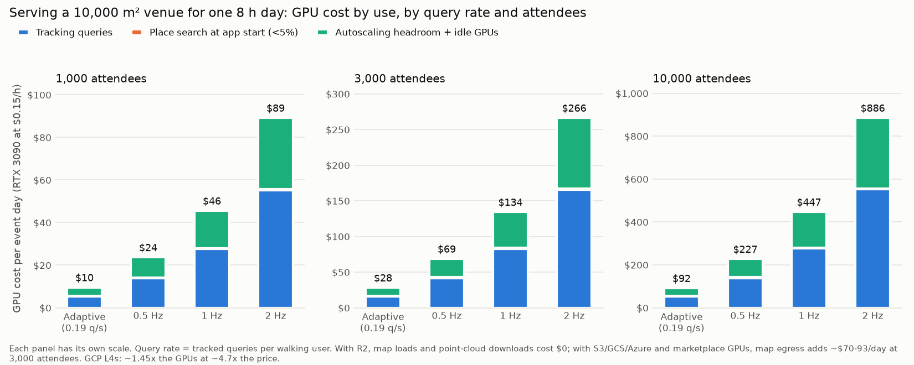

# Cost study v2: building and serving maps for a 10,000 m² conference venue

**For:** the Placeframe team · **Measured:** 2026-11-17 on one RTX 3090 (24 GB) + i7-11700K (16 threads), with
an Insta360 X5 house capture and a 3-recording house map · **Code:** `cost/` (study, serving model, charts)

## Summary

- **Builds are 3–6x faster than in our first study, and now scale linearly.** A 9,072-image map builds in 37 min
  (was 108 min). Projected for a 10,000 m² venue (~19,700 images, ~28 min of walking): **~1.3 h on one RTX 3090**,
  about $0.20–0.40 of rented GPU time; the first study projected 677 h for one connected map (18 h in tiles).
- **Serving cost is set by how often phones query.** For 3,000 attendees walking in breaks, an adaptive query rate
  (every 5 s while fixes agree) needs ~89 RTX 3090s at peak and 189 GPU-hours per event day: **$28/day on
  marketplace GPUs, ~$190 on cloud on-demand GPUs** (L4 or A10G). A fixed 2 Hz rate needs 8–10x more.
- **Map storage is negligible (~3 GB per venue, cents per month); data transfer is not.** GPUs that autoscale pull
  the map (~1.15 GB) each time one starts: ~770 GB/day here. From S3/GCS/Azure to GPUs in another provider that is
  **$68–93/day in egress, more than the GPUs**; from Cloudflare R2 it is $0. With GPUs in the same cloud as the
  store, egress is ~$1/day.
- **Rented GPUs:** a right-sized interruptible RTX 3090 built the 9,072-image map in 75 min for ~$0.58 (home: 37
  min), after two failed attempts. For single builds the home GPU is the better choice; renting pays off for
  parallel builds of different maps.

## 1. Building maps

| Map | Images | First study | Now | Of which mapping |
|---|---|---|---|---|
| house, first 25% of the walk | 564 | 221 s | 216 s | 110 s |
| house, 50% | 1,134 | 1,567 s | 436 s | 236 s |
| house, full walk | 2,268 | 5,749 s | 1,018 s | 617 s |
| house x2, joined into one map | 4,536 | 2,831 s (separate copies) | 1,024 s | 236 s |
| house x4, joined into one map | 9,072 | 6,480 s (separate copies) | 2,194 s | 477 s |
| real merge: 3 recordings of one house | 8,370 | — | 2,075 s | — |

- What changed: GPU bundle adjustment (Ceres + cuDSS) for all builds, and the prior-pose mapper for multi-recording
  maps (frames start at their capture poses; pose-prior bundle adjustment instead of incremental registration).
- x2/x4 tile the full walk side by side (2 m apart) in one reconstruction with one bundle adjustment, so
  retrieval, pairing and mapping run over the whole joined area. A "virtual bridge" of synthetic matches between
  tiles would need synthetic 3D points projected into frames on both sides; with the prior-pose mapper the tiles
  are already placed in one model by their priors, and the bridge would add a few hundred matches, so it was not
  built. The real 3-recording merge is a genuinely connected large map and lands on the same line.
- **Where the time goes now:** in joined maps, feature extraction (~33%) and matching (~36%) dominate; mapping is
  ~22%. Merges now reuse the base map build's features and matches: on a Fairhills merge (8,748 images, 46% of them
  already in the map) the build took 1,700 s instead of 2,075 s (-18%) with the same localization quality; matches
  were reusable for only 27% of pairs, because the map's images get new pose priors in a merge and many
  nearest-neighbour pairs change. Kept outputs cost ~0.25 GB per 1,000 images, pruned nightly for maps that are no
  longer active.
- Preprocessing of each X5 recording (calibration, odometry, stitching) runs on the CPU, ~25 min per 14-min
  recording; odometry and stitching now run side by side (~5 min saved), and a second recording's preprocessing
  overlaps the first one's reconstruction.

**Venue projection** (open halls walked in ~6 m lanes at ~1 m/s; images per second of walking as in the house
capture; seconds per image as in the joined and merged maps):

| | Value |
|---|---|
| Walking to capture 10,000 m² | ~28 min (one or more X5 recordings) |
| Map images | ~19,700 |
| Server build, one RTX 3090 | ~1.3 h ($0.20–0.40 at $0.15–0.30/h rented) |
| Preprocessing (CPU) | ~50 min |
| Stored: map (~1.15 GB) + capture kept for rebuilds (~2 GB) | ~3.2 GB |

**Memory (found after the study, fixed).** The reconstructor held every image's descriptors in RAM at full
precision (~1.3 MB per image), made a second full-precision copy of all of them to train the compression, and the
matcher moved all of them to the GPU at once: the 9,072-image map peaked at 18 GB of RAM, so a ~19,700-image venue
would not fit this machine (30 GB RAM, 24 GB GPU). Now descriptors are kept in half precision, the matcher moves
only each batch's images to the GPU, and the compression is trained on a 1M-descriptor sample:

| 9,072-image map | Full precision | Half precision |
|---|---|---|
| Peak reconstructor RAM | 18 GB | 11.9 GiB |
| Peak GPU memory | — (all descriptors) | 4.9 GB |
| Registered images | 8,508 / 8,532 (two builds) | 8,556 |
| Reprojection error, median | 0.69 px | 0.68 px |

Matches are identical in half and full precision (307,078 on a test batch).

**Measured at venue size.** The full walk tiled 4×2 into one map (`j8`: 18,144 images, close to the venue's ~19,700)
built in half precision on rented RTX 3090s (the home GPU had stopped working). Peak memory by stage:

| Stage | Peak process RAM | Peak GPU memory |
|---|---|---|
| Feature extraction | 4.6 GiB | 2.3 GB |
| Compression training (OPQ/PQ) | 13.7 GiB | 2.3 GB |
| Matching | 13.7 GiB | 5.1 GB |
| Mapping (prior-pose mapper, bundle adjustment) | **23.4 GiB** | 0.5 GB |

The map: 16,830 images registered, 268,239 points, median reprojection error 0.69 px (as in the smaller maps).
**Mapping, not the descriptors, now sets the peak:** 23.4 GiB at 18,144 images, so a ~19,700-image venue needs
about 25 GiB. It fits one 32 GB machine, with little room for other services on it; a 64 GB host is the safe choice.

Stage times on the rented hosts (two Quebec hosts; both slower than the home machine): feature extraction
59 min, matching 31 min, verification 2 min, mapping 22 min. Two of four rented instances stopped without a reason
from Vast (preemption, or the 40 GB disk); the job resumed from its feature and match checkpoints each time. The
build cost ~$1.00 in total. Data: `cost/venue_build/`.

**Tiles instead of one map.** Overlapping tiles in one world frame limit build memory per tile and build in
parallel. Serving stays at one map per query if the overlap is wide enough: the localizer sends each tracked query
to the tile whose core holds the predicted position, and changes tile only when the phone is half the overlap
past the core border (`TileRouter`, localizer `tiles.py`). We tested it on the Fairhills house: its capture split
into 2 tiles with a 3 m overlap (`fleet/tiler.py`), each tile built on a rented RTX 3090, and the recorded
286-frame walk replayed against the single map and the routed tiles (`bench/tile_replay.py`, `tile_analyze.py`):

| | Single map (8,370 images) | 2 tiles (6,102 + 7,368 images) |
|---|---|---|
| Served pose within 0.5 m / wrong by > 1 m | 277 / 6 of 285 | 278 / 5 of 285 |
| Queries matched against more than one map | — | 1 of 286 (the first frame, no prediction) |
| Tile switches on the walk; served pose jump at a switch | — | 8; 6–25 mm |
| Peak build memory | — | 7.9 / 10.4 GiB |

In this small house the 3 m overlap repeats 63% of the frames; in a venue, tiles of ~50 × 50 m with a 5 m
overlap repeat ~44%, and a ~19,700-image venue in 4 such tiles needs ~7,100 images (~10 GiB) per tile. Data:
`cost/tiles_fairhills/`. Next: send the first query to one tile with one retrieval over all tiles, and use the
router in `POST /localization/track`.

## 2. Rented, right-sized GPU

The x4 map (9,072 images) built on one interruptible Vast.ai RTX 3090 with a host like ours (≥8 cores, ≥32 GB RAM),
filtered for reliability (>0.99) and fast downloads (≥2 Gbit/s), not the cheapest large GPU:

| Stage | Rented RTX 3090 (Quebec, $0.305/h) | Home RTX 3090 |
|---|---|---|
| Create instance to building (worker environment 4.3 GB + capture 0.96 GB) | ~7.5 min | — |
| Feature extraction | 23.5 min | 12.2 min |
| Matching + verification | 20.5 min | 15.6 min |
| Mapping | 18.3 min | 8.0 min |
| Results back home (2.8 GB) | 3.7 min | — |
| **Total** | **74.7 min, ~$0.58** (GPU $0.38 + host download charge $0.20) | **36.6 min** |

The rented host was ~1.8x slower than ours on the same GPU model (CPU-side image decoding and mapping), and data
movement added ~11 min. Two earlier attempts the same night failed: a host in China spent 32 min downloading before
it was stopped (interruptible: likely outbid), and a host in Czechia failed to start. They exposed two bugs in our
fleet code, both fixed (an unchanged progress update did not refresh the lease, so the job was re-leased to the home
GPU; a restarted lease agent left an orphaned job the broker kept renting for). Total spend for the night ~$0.85.

**Conclusion:** at ~1.3 h per venue map on a home GPU, renting does not pay for a single build; it pays for
parallel builds of different maps. Filter hosts by reliability, download speed and region as well as price, and
expect interruptible instances to be lost.

## 3. Serving: 3,000 attendees in a 10,000 m² venue

**Load model.** An 8 h programme of 45-minute sessions and 15-minute breaks. 5% of attendees localize during
sessions; in breaks 75% walk with the app, ramping up over the first 3 min and down over the last 4. A phone that
starts localizing sends ~10 queries (at 2 Hz) until its place is confirmed, then tracks at the policy's rate. The
adaptive policy's rate (0.19 queries/s while walking) and its accuracy were measured by replaying a recorded
5-minute phone walk: 4x fewer queries than 1 Hz with the same accuracy.

**Throughput** (measured, one RTX 3090, tracked queries through the API, two localizer processes with sessions
routed by id): 4.9 q/s with one client (p50 193 ms), 8.0 q/s with four (p50 428 ms), 9.6 q/s with eight (p50 774 ms);
one process topped out at 7.9 q/s with the GPU a third idle. We plan with 8 q/s per GPU (latency under 0.5 s),
autoscaled every 5 minutes with 30% headroom.

**What limits a GPU: the CPU, not the API.** We ran the localizer's tracked path in-process (no API, no HTTP;
`bench/localizer_profile.py`) on rented GPUs with the same map and walk (data in `cost/serving_profile/`):

| GPU and host CPU | One request, median | 1 session | 2 processes, 8 sessions |
|---|---|---|---|
| Home RTX 3090, i7-11700K, through the API | 193 ms | 4.9 q/s, GPU 34% busy | 9.6 q/s, GPU 75% |
| Rented RTX 3090, Ryzen 5 5600 (via dstack) | 238 ms | 4.0 q/s, GPU 32% | 9.6 q/s, GPU 76% |
| Rented RTX 3090, Ryzen 9 5900XT | 208 ms | 4.4 q/s, GPU 36% | 7.4 q/s, GPU 62% |
| Rented RTX 3090, EPYC 7532 (2.4 GHz) | 496 ms | 2.0 q/s, GPU 13% | 3.5 q/s, GPU 25% |
| Rented L4, Xeon 8268 (2.9 GHz) | 536 ms | 2.3 q/s, GPU 21% | 5.5 q/s, GPU 65% |

One request on the Ryzen host, by stage: matching 70 ms, pose RANSAC and refinement 45 ms, descriptor decoding (PQ)
17–30 ms, global descriptors 23 ms, release of cached GPU memory 12 ms, local features 11 ms, image decoding 9 ms,
other Python work 18 ms. About 115 ms of the 208 ms is CPU work, and each process does it for one request at a
time, so the GPU waits. On the slow CPU even the GPU stages are slower (global descriptors 121 ms instead of 23 ms):
the CPU cannot give the GPU work fast enough. The API adds little: the home results through the API are as fast as
the in-process results on a similar CPU. A cap of 4 CPU threads per process made no difference, so the cause is
the CPU work per request, not threads that compete.

So: **rent GPUs with a fast CPU (≥4 GHz per core)**; a slow-CPU host gives less than half the throughput from the
same GPU. The next gains are in the CPU work (keep cached GPU memory between requests, decode only the descriptors
that matching needs, more localizer processes per GPU), not in the GPU or the API.

| Query policy | Queries per day | Peak q/s | Peak GPUs | GPU-hours/day | Vast RTX 3090 ($0.15/h) | GCP L4 ($0.71/h, 5.5 q/s each) | AWS A10G ($1.01/h) |
|---|---|---|---|---|---|---|---|
| fixed 2 Hz | 32.1 M | 4,619 | 751 | 1,777 | $266 | $1,832 | $1,794 |
| fixed 1 Hz | 16.2 M | 2,369 | 385 | 896 | $134 | $927 | $905 |
| **adaptive** | **3.3 M** | **547** | **89** | **189** | **$28** | **$192** | **$191** |

Peak GPUs and GPU-hours are for RTX 3090s at 8 q/s. **L4, measured:** on a rented L4 (Xeon 8268, 2.9 GHz) the same
in-process test gave 5.5 q/s (2 processes, 8 sessions, GPU 65% busy), against 7.4–9.6 for RTX 3090s, so an L4 day
needs ~1.45x the GPUs (adaptive: 130 at peak, 271 GPU-hours). Its GPU stages are also slower (matching 101 ms
against 70 ms). A10G: not measured (no Vast offers); its column assumes the RTX 3090's rate.

**Storage and transfer** (adaptive policy; the map pulled by every GPU server as it starts, ~670 starts/day; the
app downloads a ~1 MB point cloud per session; query images go straight to the GPUs):

| Store | Storage | Egress/day, GPUs at a marketplace | Egress/day, GPUs in the same cloud |
|---|---|---|---|
| **Cloudflare R2** | $0.05/month | **$0** | $0 |
| AWS S3 Standard | $0.07/month | $70 | $0.79 |
| GCS Standard | $0.06/month | $93 | $1.05 |
| Azure Blob Hot | $0.06/month | $68 | $0.76 |

## 4. Cost stack-up: building once, serving every day

All prices are rented RTX 3090 time at $0.15/h, with storage on Cloudflare R2 (code: `cost/stackup.py`; data:
`cost/stackup.json`).

| Map | Images | Preprocessing (CPU) | Feature extraction | Compression training | Matching | Verification | Mapping | Total |
|---|---|---|---|---|---|---|---|---|
| House, full walk (measured) | 2,268 | 6 min | 3 min | 0.2 min | 3 min | 0.6 min | 10 min | 23 min, $0.06 |
| 4 houses joined (measured) | 9,072 | 23 min | 12 min | 0.7 min | 13 min | 2.6 min | 8 min | 59 min, $0.15 |
| 10,000 m² venue (projected) | 19,700 | 50 min | 27 min | 1.5 min | 28 min | 5.6 min | 17 min | 129 min, $0.32 |

Building a venue map costs about $0.32 and about 2 hours, once per venue. Preprocessing on the CPU is the
largest stage. Storage of the map and its capture is about $0.05 per month.

| Attendees | Adaptive (0.19 q/s) | 0.5 Hz | 1 Hz | 2 Hz |
|---|---|---|---|---|
| 1,000 | $10 | $24 | $46 | $89 |
| 3,000 | $28 | $69 | $134 | $266 |
| 10,000 | $92 | $227 | $447 | $886 |

Serving cost per event day grows in proportion to attendees × query rate. Of the GPU spend, 55–62% serves
tracking queries, 0.5–4% serves the place search when an app starts, and **37–41% is autoscaling headroom and GPUs
that are provisioned but not busy** (30% headroom, and each 5-minute window sized for its peak). One event day of
serving costs about 90 times the venue map's build at the adaptive rate, and 830 times at 2 Hz.

## 5. Recommendations

1. **Query adaptively** (done in our client): the largest single factor in serving cost.
2. **Keep the map next to the GPUs, or on R2.** Marketplace GPUs plus R2, or cloud GPUs plus the same cloud's store;
   avoid paying egress for every scale-up. Keeping a few GPUs warm through sessions also cuts map loads.
3. **Pack more per GPU:** two localizer processes per GPU (sessions routed by id) raised throughput ~20% (done).
   The GPU is still ~25% idle because each request needs ~115 ms of CPU work (measured; the API adds little).
   Rent GPUs with a fast CPU, and cut the CPU work per request next.
4. **Reuse base features and matches in merges** (done: -18% on a merge with half its images already mapped).
5. **Rent for parallel builds, not single venue builds.**
6. **Keep descriptors in half precision** (done: build RAM 18 → 11.9 GiB with the same map quality). Measured at
   venue size (18,144 images), the build peaks at 23.4 GiB in mapping: it fits a 32 GB machine; rent 64 GB hosts.
7. **Cut the idle share (37–41% of serving).** Scale in 1-minute windows instead of 5, start GPUs before each
   break (the programme is known), and use less headroom with a short request queue; together we expect 15–25% less
   GPU spend. Not yet measured.
8. **Cut the CPU work per request (~115 of 208 ms).** Keep PyTorch's cached GPU memory between requests (12 ms),
   cache decoded descriptors of recently matched map images (17–30 ms), and run pose RANSAC with fewer iterations
   when the tracker gives a prior; then run 3–4 localizer processes per GPU on a 16-core host. We expect 20–30%
   more queries per GPU. Not yet measured.
9. **Query less often when tracking is good.** Every halving of the rate halves the serving cost: for example every
   8–10 s instead of 5 s while fixes agree and the odometry reports good tracking.

## Assumptions and caveats

- One venue model; attendee behaviour (active fractions, ramps, sessions per attendee) is assumed, not measured.
- Localization throughput was measured on one map (8,370 images) with one recorded walk; larger maps retrieve over
  more images (linear, small) and match the same number of pairs.
- The in-process serving profile ran on rented hosts (Ryzen 9 5900XT, EPYC 7532), not at home: the home GPU stopped
  working (it fell off the PCIe bus) before the profile. Cost of the four runs: ~$0.25.
- Prices: Vast.ai interruptible from live offers on 2026-11-17; cloud on-demand list prices; storage and egress from
  provider price pages (R2: no egress fees).
- The x4 build ran while a recording was preprocessed at low priority on the same machine; its extraction time may
  be slightly high.
